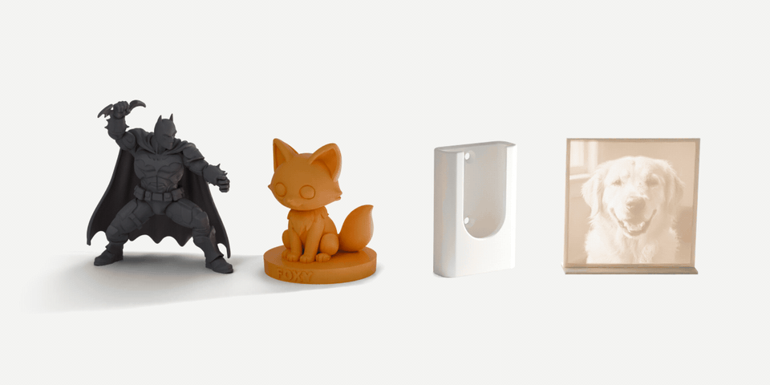
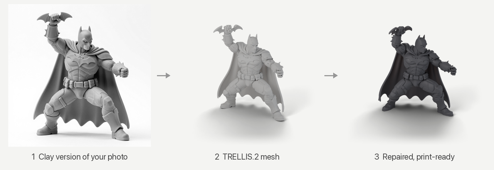
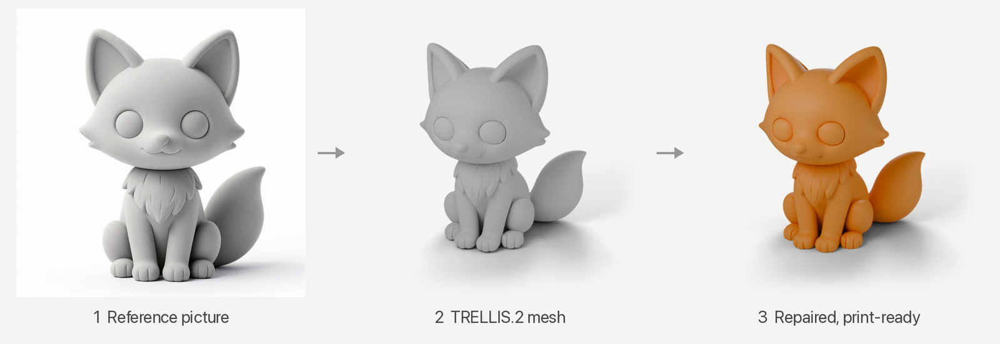
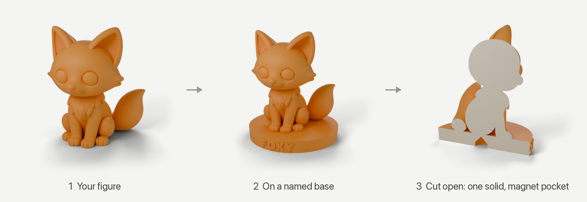
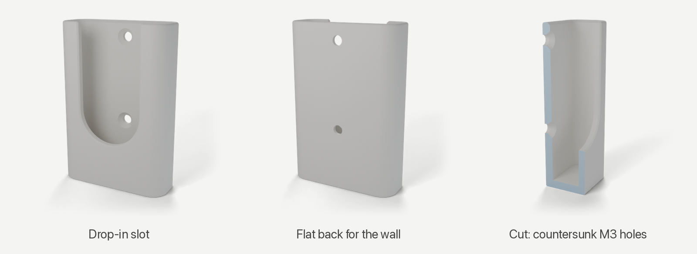
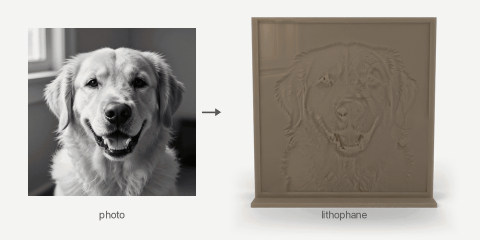
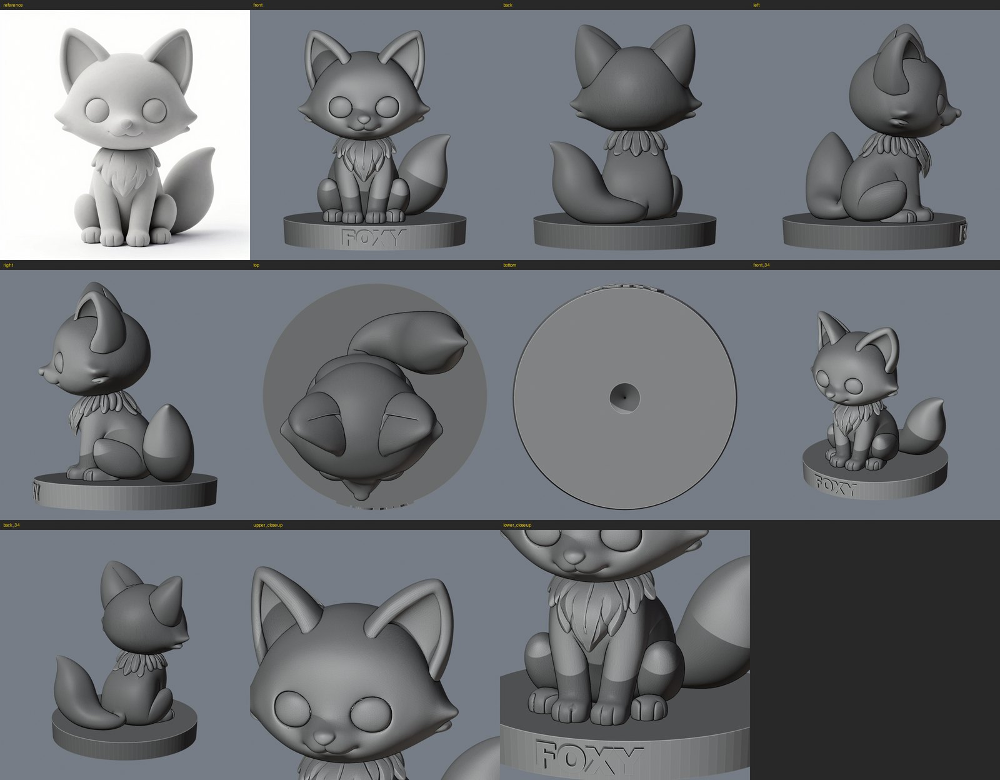

<p align="center">
  
</p>

<h1 align="center">print-studio</h1>

<p align="center">
  <b>Describe a thing. Get a file that prints.</b><br>
  A <a href="https://claude.com/claude-code">Claude Code</a> skill that designs, generates, fixes and test-slices 3D models
  for Bambu Lab printers, with free tools that run on your own machine.
</p>

<p align="center">
  <a href="LICENSE"></a>
  
  <a href="https://agentskills.io"></a>
  
  
</p>

```text
/plugin marketplace add KvashaIhor/print-studio
/plugin install print-studio@print-studio
```

Then ask Claude for an object. It picks a route, builds the model, inspects it from every side,
slices it with your printer's presets in Bambu Studio and hands you a ready-to-print `.3mf` with the
print time and grams. Setup takes about 15 minutes: see [SETUP.md](SETUP.md).

## Examples

Each heading is the kind of request that starts a route; the pictures are real outputs of the
skill's tools, not mock-ups. Print times and weights are Bambu Studio's estimates for a P1S with a
0.4 mm nozzle and PLA.

### "Can you make a Batman figurine like the one in this photo?"



A local image model re-renders your photo as an unpainted clay sculpture of the same design and
pose, TRELLIS.2 turns that into a mesh, and the skill repairs it into one printable solid, checking
the cape, the raised batarang and the feet up close. 115 mm tall: **4 h 32 min, 56 g** at 0.12 mm
layers with supports.

### "Make me a cute fox figurine, about 80 mm tall."



A local text-to-image model draws a clay-style reference, TRELLIS.2 turns the picture into a mesh on
your Mac, and the skill repairs it into one watertight solid with a flat base.
**1 h 13 min, 33 g** with tree supports.

### "Put my fox on a round base with FOXY on the front and a hole underneath for a 10 × 3 mm magnet."



The base is fused to the figure as one body, the letters follow the curve of the base, and the
magnet pocket has a cone-shaped roof so it prints without supports.
**1 h 29 min, 49 g**.

### "I need a wall mount for my TV remote, 136 × 35 × 9 mm, two M3 screws, drop-in from the top."



Code CAD (build123d) with exact dimensions and clearances tuned to your printer: countersunk M3 holes
so the heads sit flush, a chamfered opening the remote slides into, and a small chamfer on the bed
edges against elephant's foot. Exported as STEP, STL and 3MF.
**29 min, 14 g, no supports**.

### "Turn this photo into a lithophane, about 90 mm wide."



Brightness becomes thickness (0.8 to 3.2 mm). The plate stands on its own foot, nothing overhangs
more than 45°, and you see a back-lit preview before printing. (The dog photo is AI-generated.)
**1 h 58 min, 27 g** at 0.12 mm layers.

## How it checks its work

Nothing is handed over until it passes three gates:

1. **Mesh check.** Watertight, a single body, wall thickness, overhangs, stability on the bed, fits
   the build volume. Every script exits with an error on a bad result instead of printing a warning
   and carrying on.
2. **Look at it.** Headless Blender renders a 10-view sheet plus close-ups of the details that matter
   (faces, text, mating features, the underside). Claude looks at them, and defects can be picked by
   pixel and fixed locally.
3. **Slice it.** The Bambu Studio command line slices the model with your printer's presets. You get
   the print time, grams of filament, and where supports actually end up (read from the G-code).



## What it can make

| Route | Examples | How |
|---|---|---|
| **Functional parts** | brackets, hooks, wall mounts, enclosures, adapters, spacers, clips | code CAD (build123d) with exact dimensions and printer-tuned clearances; STEP + STL + 3MF |
| **Modify an existing mesh** | rescale, cut into parts with pins, hollow, add text, magnet or nut pockets, plinths, booleans | trimesh + manifold3d |
| **2D → 3D** | lithophanes, image reliefs, logos/SVG, name signs, keychains, cookie cutters | height fields from images, SVG extrusion |
| **Organic shapes** (Apple Silicon only) | figurines, animals, busts, decor, a figure from your photo | local text-to-image or photo-to-clay (mflux), then image-to-3D (TRELLIS.2), then mesh repair |
| **Hybrids** | an AI figure on a plinth with a name and a magnet pocket | routes chained |

## Install

**As a Claude Code plugin** (recommended):

```text
/plugin marketplace add KvashaIhor/print-studio
/plugin install print-studio@print-studio
```

**With the [skills CLI](https://skills.sh)**, which also installs into other agents that read
`SKILL.md` (Codex, Cursor, Gemini CLI and more; only Claude Code has been tested):

```bash
npx skills add KvashaIhor/print-studio
```

**By hand:** copy `skills/print-studio/` to `~/.claude/skills/print-studio/`.

Then follow **[SETUP.md](SETUP.md)**: create a Python environment, install Blender and Bambu Studio,
and write your config (`~/.config/print-studio/printer.json`).

## Requirements

| | Needed for |
|---|---|
| Claude Code | everything |
| Python 3.12 + `requirements.txt` | everything |
| [Blender](https://www.blender.org/) 4.x / 5.x | the render checks |
| [Bambu Studio](https://bambulab.com/en/download/studio) | slicing checks and `_sliced.3mf` |
| Apple Silicon Mac with ≥ 24 GB unified memory (photo-to-clay was only tested with 128 GB), `requirements-organic.txt`, [trellis-mac](https://github.com/shivampkumar/trellis-mac) | organic route only |

Tested on macOS 26 (Apple Silicon, 128 GB) with a Bambu Lab P1S. On Linux and Windows:
- The functional, modify and 2D routes should work.
- Set the Bambu Studio executable and profile folder in the config (see SETUP.md).
- These platforms are untested, so reports are welcome.

## Configuration

All machine-specific settings live in one JSON file; start from `skills/print-studio/config/printer.example.json`. It holds:
- the printer, nozzle and build volume
- clearances and minimum wall thickness
- Bambu Studio preset names
- tool paths

Record clearances confirmed by your own test prints under `proven`, so later parts reuse them.

## Third-party models and licences

This repository contains only code and documentation (MIT). The organic route downloads models at first use, under their own licences:
- **TRELLIS.2** (Microsoft): MIT.
- **DINOv3** (Meta): custom licence, gated on Hugging Face.
- **RMBG-2.0** (BRIA): CC BY-NC 4.0, non-commercial.
- **Z-Image-Turbo**: Apache 2.0. **Qwen-Image-Edit-2511**: see its Hugging Face model card.

Check these before selling anything made with the organic route. Fan models of known characters are for personal use.

## Status

v0.1: built and tested by one person on one printer. Expect rough edges, and please open an issue
with the prompt and the result when something goes wrong.

## License

MIT, see [LICENSE](LICENSE).
